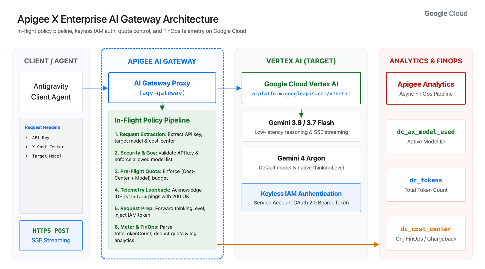

# Apigee Enterprise AI Gateway for Antigravity

This repository contains a sample template to serve as a reference implementation for deploying Apigee as a secure AI gateway for Google Antigravity.

* Designed as a starting point to show how to govern, secure, and route Antigravity traffic.
* Configured entirely using OOTB Apigee policies with zero custom scripting.
* Demonstrates how to satisfy Google Enterprise Gateway guidelines by preserving mandatory client attribution headers and utilizing centralized service account authentication (https://docs.cloud.google.com/gemini/enterprise/docs/ai-developer-tools/deploy-enterprise-gateway)

---

## Architecture Overview



---

## How This Satisfies All Enterprise Gateway Requirements

| Enterprise Gateway Requirement | How Apigee X (`agy-gateway`) Implements It |
| :--- | :--- |
| **1. Preserve Client Attribution Headers**<br>(`User-Agent`, `X-Goog-Api-Client`, `X-Cost-Center`) | Apigee preserves client attribution headers verbatim by default, strips gateway credentials (`Authorization`, `x-api-key`, `x-goog-api-key`), and injects `X-Goog-User-Project`. |
| **2. SSE Streaming & Payload Normalization**<br>(`:streamGenerateContent?alt=sse`) | Forwards SSE streams (`text/event-stream`) from Vertex AI and declaratively normalizes `thinkingConfig` (`includeThoughts: true, thinkingBudget: 0`) via Apigee Message Templates. |
| **3. Acknowledge IDE Telemetry Endpoints**<br>(`POST /v1beta:*` $\rightarrow$ `HTTP 200 OK` `{}`) | Handled via a loopback `<RouteRule>` and `AssignMessage` policy so Antigravity IDE telemetry pings (`POST /v1beta:recordTelemetry`) return `200 OK` `{}` without hitting Vertex AI. |
| **4. Multi-Header API Key Auth**<br>(`Authorization: Bearer <KEY>`, `x-goog-api-key`, `?key=`) | Extracts the API key from `Authorization: Bearer <KEY>` (or `x-goog-api-key` / `?key=`) and validates it via **VerifyAPIKey** against the Apigee API Product (`api-product.json`). |
| **5. Model Allowlisting & Per-Department Token Quotas** | Enforces strict model allowlisting and daily token budgets per `(X-Cost-Center, model)` combination using Apigee's **LLM Token Quota** policy and [`api-product.json`](./api-product.json). |
| **6. FinOps Chargeback Analytics** | Captures the requested model (`dc_ax_model_used`), consumed tokens (`dc_tokens`), and department (`dc_cost_center`) directly into **Apigee Analytics** via **DataCapture**. |

---

## Quickstart

### 1. Deploy to Apigee X

Set your GCP Project / Apigee Organization, Environment, and Environment Group Hostname, then run [`./deploy.sh`](./deploy.sh):

```bash
export PROJECT_ID="<YOUR_GCP_PROJECT_ID>"
export APIGEE_ENV="<YOUR_APIGEE_ENV>"
export APIGEE_HOST="<YOUR_APIGEE_HOSTNAME>"

./deploy.sh
```

`./deploy.sh` automatically:
1. Creates the `llm-proxy@${PROJECT_ID}.iam.gserviceaccount.com` Service Account and grants `roles/aiplatform.user` (if not already present).
2. Creates the Apigee Analytics Data Collectors (`dc_ax_model_used`, `dc_tokens`, `dc_cost_center`).
3. Packages, imports, and deploys the `agy-gateway` proxy bundle.
4. Configures the API Product (`agy-gateway-product`) from [`api-product.json`](./api-product.json).
5. Creates the Developer and Developer App (`agy-gateway-app`) and prints your **Consumer API Key**.

---

### 2. Verify the Gateway (`./test-gateway.sh`)

Run the automated test suite to verify authentication, telemetry acknowledgment, model allowlisting, and SSE streaming:

```bash
export AGY_LLM_GATEWAY_URL="https://${APIGEE_HOST}/agy-gateway"
export AGY_LLM_GATEWAY_API_KEY="<YOUR_APIGEE_CONSUMER_KEY>"

./test-gateway.sh
```

---

### 3. Configure Antigravity Clients

You can connect Antigravity (`agy` CLI and IDE) using either **Environment Variables** or an **MDM `admin_settings.json` file**:

#### Option A: Environment Variables (Quick CLI Testing)

```bash
export AGY_LLM_GATEWAY_URL="https://<YOUR_APIGEE_HOSTNAME>/agy-gateway"
export AGY_LLM_GATEWAY_API_KEY="<YOUR_APIGEE_CONSUMER_KEY>"
export AGY_LLM_GATEWAY_MODELS="gemini-3.8-flash,gemini-3.7-flash,gemini-4-argon"

agy models
agy -p "Reply with PONG"
```

#### Option B: MDM `admin_settings.json` (Enterprise Rollout)

Copy [`admin_settings.example.json`](./admin_settings.example.json) to your OS-level Antigravity MDM path (with `chmod 644` on macOS/Linux):
- **macOS**: `/Library/Application Support/Antigravity/admin_settings.json`
- **Linux**: `/etc/antigravity/admin_settings.json`
- **Windows**: `C:\ProgramData\Antigravity\admin_settings.json`

```json
{
  "gateway": {
    "enabled": true,
    "url": "https://<YOUR_APIGEE_HOSTNAME>/agy-gateway",
    "apiKey": "<YOUR_APIGEE_CONSUMER_KEY>",
    "wireProtocol": "genai",
    "customHeaders": {
      "X-Cost-Center": "Platform-Engineering"
    }
  },
  "models": {
    "defaultModelId": "gemini-4-argon",
    "list": [
      { "modelId": "gemini-3.8-flash" },
      { "modelId": "gemini-3.7-flash" },
      { "modelId": "gemini-4-argon" }
    ]
  }
}
```

---

## Managing Allowed Models & Per-Department Token Quotas

All model access control and token quota limits are externalized in [`api-product.json`](./api-product.json) under `llmOperationGroup.operationConfigs`.

### 1. Pre-Configured Allowed Models (`api-product.json`)
By default, [`api-product.json`](./api-product.json) and [`admin_settings.example.json`](./admin_settings.example.json) include the following Gemini models for Antigravity Enterprise:

| Model Name | CLI / API Model ID (`modelId`) | Default Quota (`api-product.json`) |
| :--- | :--- | :--- |
| **Gemini 3.8 Flash** | `gemini-3.8-flash` | `1,000,000` tokens / day |
| **Gemini 3.7 Flash** | `gemini-3.7-flash` | `1,000,000` tokens / day |
| **Gemini 4 Argon** | `gemini-4-argon` | `1,000,000` tokens / day |

### 2. How to Add or Remove Allowed Models
Each entry in `llmOperationGroup.operationConfigs` authorizes a specific Gemini model ID and defines its token quota:
```json
{
  "apiSource": "agy-gateway",
  "llmOperations": [
    {
      "resource": "/**",
      "methods": ["POST"],
      "model": "gemini-4-argon"
    }
  ],
  "llmTokenQuota": {
    "limit": "1000000",
    "interval": "1",
    "timeUnit": "day"
  }
}
```
- **Allowing a Model**: Add an object to `llmOperationGroup.operationConfigs` with `"model": "<MODEL_ID>"` (and include that `"modelId"` in `admin_settings.json` under `models.list`).
- **Blocking a Model**: Any model **not** listed in the API Product (for example, `gemini-1.5-flash`) is automatically rejected at the gateway by the **VerifyAPIKey** policy with `InvalidAPICallAsNoApiProductMatchFound`.

### 3. How the Token Limit Applies to the Department (`X-Cost-Center`) in `admin_settings.json`
1. In `admin_settings.json`, the department or team is configured as a custom header:
   ```json
   "customHeaders": {
     "X-Cost-Center": "Platform-Engineering"
   }
   ```
2. On every request, the gateway extracts `X-Cost-Center` from the header and the target model from the request path.
3. The **LLM Token Quota** policy uses the `X-Cost-Center` and model combination as an identifier against the quota limits configured in the API Product:
   - Each unique `X-Cost-Center` department (`Platform-Engineering`, `Data-Science`, etc.) gets its own independent token quota bucket per model defined by `llmTokenQuota` in [`api-product.json`](./api-product.json) (e.g., `1,000,000` tokens per `1` `day`).
   - To change a model's token budget, edit `"limit"`, `"interval"`, or `"timeUnit"` (`minute`, `hour`, `day`, `month`) in [`api-product.json`](./api-product.json) and re-run `./deploy.sh`.

---

## Optional: Automatically Injecting Workstation & User Details into `admin_settings.json` via MDM

> [!NOTE]
> **Optional Configuration (Not Required):** The default gateway setup works out of the box using `X-Cost-Center` as shown above. This section is **optional** and only needed if you want your MDM tool to automatically populate workstation or user details (`serial number`, `hostname`, or `console user`) into `admin_settings.json`.

If you want to capture device or developer identity—such as **serial number**, **hostname**, or **console user**—at the gateway layer, your MDM deployment script (Jamf Pro, Microsoft Intune, Kandji, Puppet, etc.) can dynamically query the workstation and write those values into `gateway.customHeaders` when generating `admin_settings.json`.

### Example: macOS MDM Script (Jamf / Intune / Kandji)
```bash
#!/usr/bin/env bash
set -euo pipefail

# Sample macOS MDM script to dynamically inject workstation & user details
SERIAL_NUM=$(ioreg -rd1 -c IOPlatformExpertDevice | awk -F'"' '/IOPlatformSerialNumber/{print $4}')
HOSTNAME=$(scutil --get LocalHostName 2>/dev/null || hostname -s)
CONSOLE_USER=$(stat -f "%Su" /dev/console)

TARGET_DIR="/Library/Application Support/Antigravity"
TARGET_FILE="${TARGET_DIR}/admin_settings.json"
mkdir -p "${TARGET_DIR}"

cat <<EOF > "${TARGET_FILE}"
{
  "gateway": {
    "enabled": true,
    "url": "https://<YOUR_APIGEE_HOSTNAME>/agy-gateway",
    "apiKey": "<YOUR_APIGEE_CONSUMER_KEY>",
    "wireProtocol": "genai",
    "customHeaders": {
      "X-Cost-Center": "Platform-Engineering",
      "X-Console-User": "${CONSOLE_USER}",
      "X-Workstation-Serial": "${SERIAL_NUM}",
      "X-Workstation-Hostname": "${HOSTNAME}"
    }
  },
  "models": {
    "defaultModelId": "gemini-4-argon",
    "list": [
      { "modelId": "gemini-3.8-flash" },
      { "modelId": "gemini-3.7-flash" },
      { "modelId": "gemini-4-argon" }
    ]
  }
}
EOF

# Lock permissions so root owns the file and developers have read-only access
chown root:wheel "${TARGET_FILE}"
chmod 644 "${TARGET_FILE}"
```

### Example: Windows MDM Script (Microsoft Intune PowerShell)
```powershell
$Serial = (Get-CimInstance Win32_BIOS).SerialNumber
$Hostname = $env:COMPUTERNAME
$ConsoleUser = (Get-CimInstance Win32_ComputerSystem).UserName
if (-not $ConsoleUser) { $ConsoleUser = $env:USERNAME }

$TargetDir = Join-Path $env:ProgramData "Antigravity"
$TargetFile = Join-Path $TargetDir "admin_settings.json"
New-Item -ItemType Directory -Force -Path $TargetDir | Out-Null

$Settings = @{
  gateway = @{
    enabled = $true
    url = "https://<YOUR_APIGEE_HOSTNAME>/agy-gateway"
    apiKey = "<YOUR_APIGEE_CONSUMER_KEY>"
    wireProtocol = "genai"
    customHeaders = @{
      "X-Cost-Center"          = "Platform-Engineering"
      "X-Console-User"         = $ConsoleUser
      "X-Workstation-Serial"   = $Serial
      "X-Workstation-Hostname" = $Hostname
    }
  }
  models = @{
    defaultModelId = "gemini-4-argon"
    list = @(
      @{ modelId = "gemini-3.8-flash" },
      @{ modelId = "gemini-3.7-flash" },
      @{ modelId = "gemini-4-argon" }
    )
  }
} | ConvertTo-Json -Depth 5

$Settings | Set-Content -Path $TargetFile -Encoding UTF8
```

### What Apigee X Receives on Every Prompt
Once deployed, every Antigravity IDE or `agy` CLI call automatically sends those headers to Apigee:

```http
POST /agy-gateway/v1beta/models/gemini-4-argon:streamGenerateContent?alt=sse HTTP/1.1
Authorization: Bearer <YOUR_APIGEE_CONSUMER_KEY>
X-Cost-Center: Platform-Engineering
X-Console-User: saravana
X-Workstation-Serial: C02XYZ123456
X-Workstation-Hostname: macbook-pro-saravana
```

> **Updating the Apigee Quota Identifier:**  
> Once these custom headers are added to `admin_settings.json`, if you want to enforce token quotas per user or per workstation (instead of per department), simply:
> 1. Extract the new header (e.g., `X-Console-User` or `X-Workstation-Serial`) into a variable in [`EV-ExtractRequestMetadata.xml`](./apiproxy/policies/EV-ExtractRequestMetadata.xml).
> 2. Update `<Identifier ref="..."/>` in the **LLM Token Quota** policies ([`LQ-LLMTokenQuota-Enforce.xml`](./apiproxy/policies/LQ-LLMTokenQuota-Enforce.xml) and [`LQ-LLMTokenQuota-Count.xml`](./apiproxy/policies/LQ-LLMTokenQuota-Count.xml)) to reference that extracted variable.
